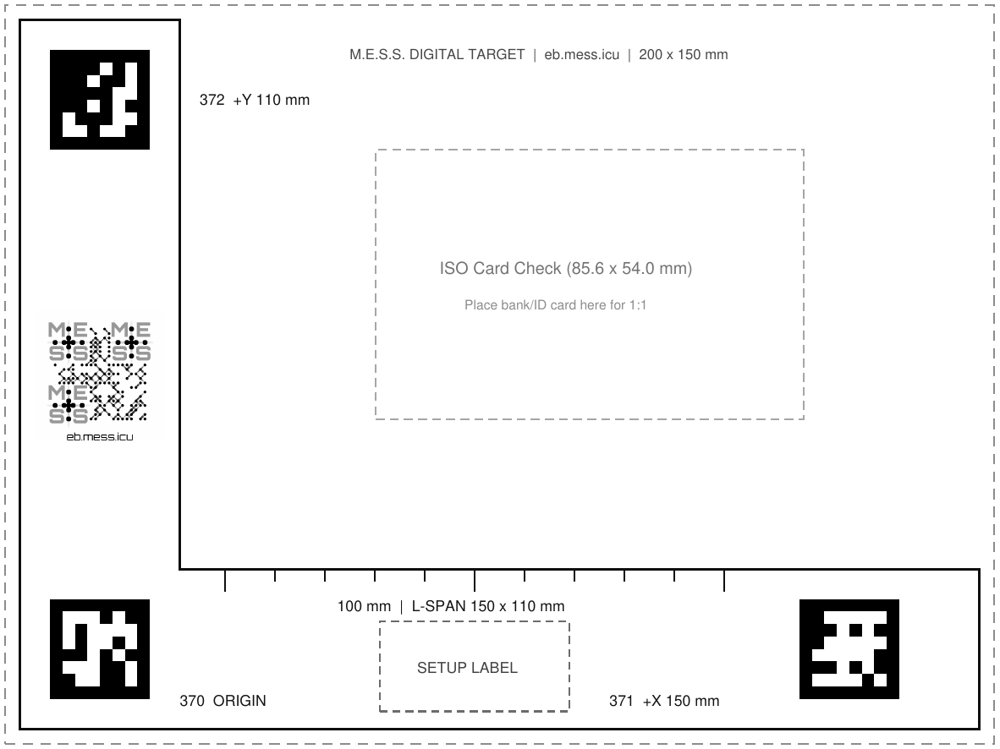

# Quest3-WebXR-AprilTag

<!-- MEDIA_SLOT: Replace with hook.mp4 / launch.mp4 / demo-full.mp4 once delivered (see docs/media.md) -->

**[Launch Quest 3 AR Demo →](https://q3.mess.engineering/examples/quest.html)** · **Track the object. Not the controller.**

**AprilTag tracking.** **Live on Quest 3.** **In your browser.**  
Hand tracking first. Controllers optional. · No Unity. No installation. Open source.  
Attach a tag. Move the object. Track it in 3D. Real objects. Real motion. Real coordinates. *Tangible Mixed Reality meets spatial measurement.*

**Live:** [q3.mess.engineering](https://q3.mess.engineering/) · `Apache-2.0` · Zero build step

---

## Get Your Markers

| **SCREEN** (`A4 · 350–352`) | **TABLET** (`20 × 15 cm · 370–372`) |
|---|---|
|  |  |
| [Open 1:1 Screen Target →](https://q3.mess.engineering/examples/target.html) · [A4 Print PDF ↗](print/sheet_A4_eb_mess_icu_en_full_pieces_print.pdf) | [Open 1:1 Tablet / e-Ink Target →](https://q3.mess.engineering/examples/target.html?mode=tablet) · [Tablet PDF ↗](print/tablet_200x150mm_370_371_372.pdf) |

Print at **100% scale** (no "Fit to Page") or size 1:1 on screen/tablet/e-Ink using a bank/ID card (`85.6 × 54.0 mm`). Details & M.E.S.S. ID ranges (`x00–x49` free, `x50–x99` reserved): [docs/markers.md](docs/markers.md).

---

## Measured on Meta Quest 3

| Native `XRAnchor` | Held-out RMS | Anchor Lock | Repeatability (`1 m`) |
|---|---|---|---|
| **89–90 FPS** *(camera off)* | **0.27–0.37 px** | **~15 ms** *(0 lost)* | **2–4 mm** |

*Meta Quest 3 (`OculusBrowser 157`, `1280×1080`) · Zero-dependency ES core in `src/`, vendored AprilTag WASM (`vendor/apriltag`) & Three.js (`vendor/three`) · Self-consistency only (`independentlyValidated: false`). Full numbers & scope: [docs/benchmarks.md](docs/benchmarks.md).*

---

## Documentation

[How It Works & Architecture](docs/architecture.md) · [Minimal Example & Quickstart](docs/architecture.md#quickstart-minimal-integration) · [Controls (`SCAN` / `MEASURE`)](docs/controls.md) · [Hardware Benchmarks](docs/benchmarks.md) · [Markers & IDs](docs/markers.md) · [Local Dev](docs/architecture.md#run-locally) · [Media Guide](docs/media.md) · [Changelog](CHANGELOG.md)

---

## License & Author

Philipp Mattern · [M.E.S.S. – Mattern Engineering & Software Solutions](https://mess.engineering)  
Licensed under **Apache-2.0** ([`LICENSE`](LICENSE)). See [`THIRD_PARTY_NOTICES.md`](THIRD_PARTY_NOTICES.md) and [`print/SOURCE.json`](print/SOURCE.json).
