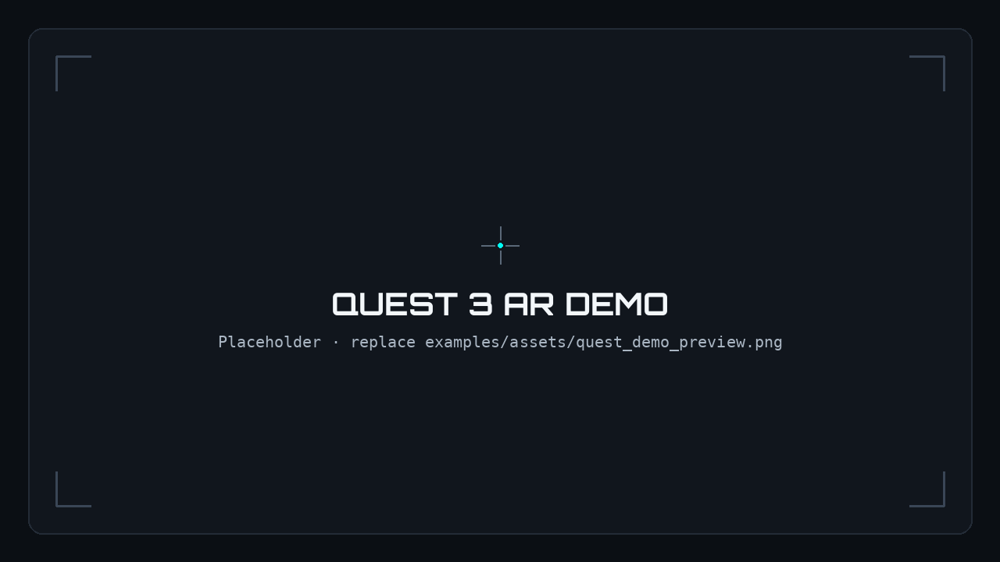
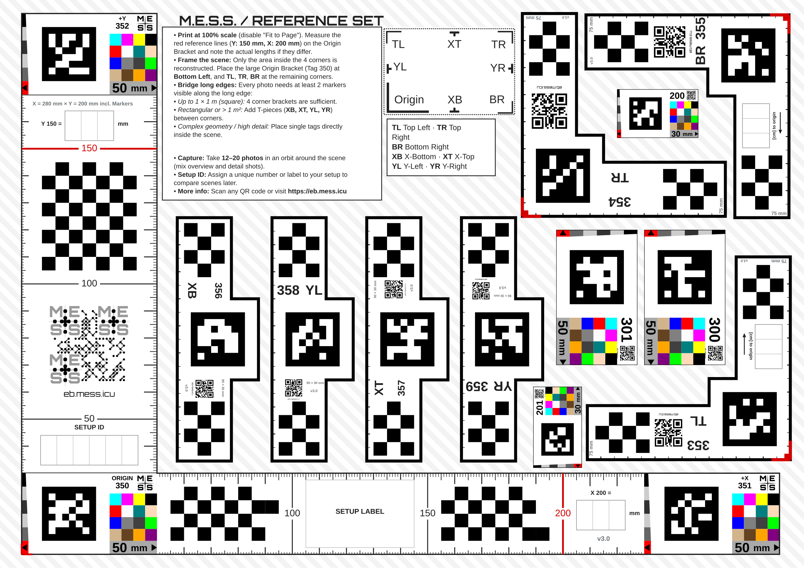

# Quest3-WebXR-AprilTag

Physical millimeter `(0, 0, 0)` WebXR anchor for Meta Quest 3 — calibrate once, lock a native `XRAnchor`, and track at 90 FPS with the camera off.

**Live:** [q3.mess.engineering](https://q3.mess.engineering/) · `v1.0.0` · `Apache-2.0` · Zero build step

[](https://q3.mess.engineering/examples/quest.html)

**[Launch Quest 3 AR Demo →](https://q3.mess.engineering/examples/quest.html)** — Meta Quest Browser (`immersive-ar`: calibrate, lock & measure)

| **SCREEN** (`A4 · 350–352`) | **TABLET** (`20 × 15 cm · 370–372`) |
|---|---|
| [](https://q3.mess.engineering/examples/target.html) | [](https://q3.mess.engineering/examples/target.html?mode=tablet) |
| [Open 1:1 Screen Target →](https://q3.mess.engineering/examples/target.html) · [A4 Print PDF ↗](print/sheet_A4_eb_mess_icu_en_full_pieces_print.pdf) | [Open 1:1 Tablet / e-Ink Target →](https://q3.mess.engineering/examples/target.html?mode=tablet) · [Tablet PDF ↗](print/tablet_200x150mm_370_371_372.pdf) |

Print the A4 sheet at 100% scale (disable "Fit to Page", [`print/SOURCE.json`](print/SOURCE.json)), or size either target 1:1 on a monitor / iPad / e-Ink reader ([`rigs/ms-qr-tablet-l.json`](rigs/ms-qr-tablet-l.json)) using a standard bank/ID card (`85.6 × 54.0 mm`).

---

## Measured on Meta Quest 3

Recorded on real Meta Quest 3 hardware (`OculusBrowser 157.0.0.22.15`, `Chrome 157`, `1280×1080`, `resizeMode: "none"`, `centered-square` zero-distortion model):

| Metric | Measured Result |
|---|---|
| Native `XRAnchor` loop & readback | `89–90 FPS`; `0.8–0.9 ms` median main-thread readback (`max 2.4 ms`, `worker-bitmap`) |
| Anchor creation & tracking stability | `~15 ms` creation; `18,777` / `11,462` / `6,109` consecutive tracked frames (`0` lost) |
| Intrinsics fit (`fx = fy`) | `866–892 px` (`trainingRmsPx: 0.37–0.48 px`, `heldOutRmsPx: 0.27–0.37 px`) |
| Capture-to-XR time offset | `-50.2` to `-53.4 ms` (`3/3` seeds converged, spread `< 1 µs`) |
| Holdout / verification consistency | `3.8–5.3 mm` / `0.63°` holdout; `0.7–5.5 mm` / `0.06–0.3°` fresh verification |
| Cross-session repeatability (`1 m` span) | `2–4 mm` on 12 mm (`200`-series) & 20 mm (`300`-series) tags; read-only audit `6–8 mm` median |
| Runtime & tests | `0` external runtime dependencies in `src/` · `110` passing unit tests |

*Note: Reprojection and self-consistency metrics are not an independent physical metrology certification (`independentlyValidated: false`). Anchors are session-scoped (`persistent: false`); calibrated camera profiles persist in `localStorage` across sessions.*

---

## How It Works

WebXR starts `(0, 0, 0)` in an arbitrary room frame, while Quest Browser's `getUserMedia()` passthrough stream exposes no calibrated intrinsics, no camera-to-headset offset, and ~50 ms of capture delay. Calibrating all three once lets native WebXR SLAM take over completely:

1. **Calibrate once:** Orbit your head around a flat, stationary 3-tag L-angle (`350 / 351 / 352`, `tag36h11`, or `370 / 371 / 372` on tablet). A background Web Worker solves camera intrinsics (`K`), `viewerFromCameraGL`, and `timeOffsetMs`, checks held-out and fresh views, and caches the profile in `localStorage`.
2. **Lock native `XRAnchor`:** Collect 5 consistent 3-tag views, call `frame.createAnchor(rigid, referenceSpace)` once, and **stop the camera**. `frame.getPose(anchor.anchorSpace, referenceSpace)` drives the scene at 90 FPS with zero optical fallback.
3. **Work in `SCAN` or `MEASURE`:** Stay in camera-off 90 FPS `MEASURE` mode for probing and pinning, or switch to `SCAN` when locating perimeter markers, tracking movable tags, or recording 3D paths.

```text
worldFromL = worldFromViewer(captureTime + timeOffsetMs) × viewerFromCameraGL × cameraFromL(captureTime)
```

---

## Controls (`examples/quest.html`)

- **Startup:** **Prepare camera** → **Enter AR** → follow the orbital reticle (calibrate once or verify cached profile) → hold the 3-tag L-angle steady for 5 frames to lock. Optional debug HUD panels start `OFF` (`HUD ON/OFF` in the Wrist Menu or Controller `A/X`).
- **`SCAN` mode (camera ON · red hand tint):**
  - **M.E.S.S. ID convention (`tag36h11`):** Only the first 50 IDs per 100-block (`x00–x49`) are free user-assignable AprilTags (e.g. `200–249` at 12 mm, `300–349` at 20 mm); IDs from `x50` upward (`x50–x99`, e.g. `250–299` and `350–399`) are reserved M.E.S.S. system/reference ranges (L-angles `350–352` / `370–372`, perimeter pieces `353–359`).
  - Reserved perimeter markers (`353–359`, activated via `TL`, labeled `YL`, `TL`, `XT`, `TR`, `YR`, `BR`, `XB`) build a 20 cm clockwise table fence; free 20 mm tags (`300–349`) auto-lock and follow via **multi-tag rigid ruler 90 Hz hand coupling** (supports gripping two rigidly mounted tags simultaneously under rotation up to `~0.42 m` lever arm, snapping back to the optical pose on timeout/drift so tags never drift off in mid-air), **proximity-prioritized Focus-ROI tracking** (`20–28 Hz` on the closest active targets with `decimate = 1.5` motion-blur retry), and damped 6DOF optical lead prediction inside thicker shimmering frames; other detected tags with defined edge classes (such as free 12 mm tags `200–249`) place static locked markers scaled by ID class (`requiredTagEdgeMm`) with their ID rendered flat on the tag matrix.
  - Hold a fingertip `0.40 s` on the bottom **`[⏱ MARK]`** pill below any tag (in mid-air or flat on the table, kept clear of left/right grabbing fingers) for a **Time-Copy** point marker at its live 3D pose; hold **`[● REC]`** (`0.65 s` start / `0.35 s` stop) above a tag to record a velocity-modulated 3D pathline (`0–550 mm/s` thickness scale) with waypoint dots.
  - Switch modes or reset user data on the anchored L-angle bar: **`[■ MEASURE / ● SCAN]`**, **`[◈ FENCE]`**, **`[↺ CLEAR ALL]`** (clears user-scanned tags, trails, time-copies & pins while keeping the Perimeter Fence active), or use frontal **Left Fist Hold (`0.85 s`)** / Controller Grip.
- **`MEASURE` mode (camera OFF · 90 FPS · green hand tint):**
  - Pure native WebXR anchor tracking — low power and free of optical stutter.
  - Hover any locked tag, Time-Copy, or path point with your index fingertip to reveal the full 3D tag square, orientation plane, speed (`mm/s`), and `X / Y / Z / Floor`.
  - **Index + Thumb Pinch** (left or right hand) or hover card **`[📌]`** orb pins/unpins points for live pairwise 3D distance rails (`mm`, `ΔZ`, `Δt`).
  - **Gated Wrist Menu** (`1.2 s` steady frontal palm gaze or tap inner Wrist-Dot, `120 ms`): `↺ CLEAR ALL` (preserves Perimeter Fence), `HUD ON/OFF`, `Q: AUTO/FLUID/CRISP`, `RANGE: AUTO 1.5 / EXP 1.0` (Auto caps at `decimate = 1.5` when steady and locks to `decimate = 2` whenever moving/active; `EXP 1.0` enables idle-only `decimate = 1` above `78 FPS`), and `↺ RECALIBRATE`.
- **Re-anchor & Exit:** `1× Trigger` on tracking loss (`lost` / `failed`), `2× Trigger (≤ 1.5 s)` while `tracking` (controller); hold **Left Thumbstick** or **`B`/`Y`** (`1.4 s`) to exit AR.

---

## Run Locally

Zero build step required (Node `>= 22` for tests and the static server):

```bash
# 1. Run automated tests
npm test

# 2. Start the zero-dependency static server (serves index.html at /)
npm run serve

# Optional: serve under a subpath (production serves at the domain root q3.mess.engineering)
node scripts/serve.mjs --base /Quest3-WebXR-AprilTag

# 3a. Meta Quest 3 over USB (localhost is a Secure Context, no TLS cert needed)
adb reverse tcp:8443 tcp:8443
# Open in Meta Quest Browser: http://localhost:8443/examples/quest.html

# 3b. Or serve over LAN HTTPS with your own certificate
node scripts/serve.mjs --cert cert.pem --key key.pem --host 0.0.0.0 --port 8443
```

---

## Library Modules (`src/`)

Core calibration, pose, anchor, hand-coupling, and runtime modules under `src/` are pure ES modules with zero Three.js or framework dependencies. Three.js (`vendor/three`) is only imported by [`examples/quest.mjs`](examples/quest.mjs) and the optional rendering helpers [`src/ui-atlas.mjs`](src/ui-atlas.mjs) and [`src/render-batch.mjs`](src/render-batch.mjs). Physical rig and print-sheet definitions live in [`rigs/ms-qr-main-l.json`](rigs/ms-qr-main-l.json), [`rigs/ms-qr-tablet-l.json`](rigs/ms-qr-tablet-l.json), and [`print/SOURCE.json`](print/SOURCE.json).

| Module | Responsibility |
|---|---|
| `src/camera.mjs` + `src/detector-worker.js` | `getUserMedia`, atomic `requestVideoFrameCallback` capture, off-thread `VideoFrame` / `ImageBitmap` readback, AprilTag 36h11 WASM, Focus-ROI near-tracking (`detectFocusRois`) |
| `src/rig.mjs` | Planar rig validation, homography + Gauss-Newton PnP (`fitPlanarPose`), strict-majority subset consensus, `requiredTagEdgeMm` |
| `src/solver.mjs` + `src/calibration-worker.mjs` | Pseudo-Huber Schur-complement intrinsic BA, multi-seed hand-eye + `timeOffsetMs` solver, 80/20 holdout validation |
| `src/assistant.mjs` + `src/profile.mjs` | Guided cold-start / cached-profile verification state machine, SHA-256 `localStorage` cache, `createObservationBuffer` |
| `src/anchor.mjs` | 5-view stability collector, synchronous `frame.createAnchor`, explicit `reanchor()`, zero optical fallback |
| `src/runtime.mjs` | Zero-dependency column-major 4×4 rigid-transform & quaternion math, SLERP pose interpolation |
| `src/hand-coupling.mjs` + `src/hand-gesture.mjs` | 90 Hz rigid-palm & multi-tag ruler hand-tracking coupling for movable tags (`300–349`) and scale-invariant fist/wrist gestures |
| `src/tag-predictor.mjs` | Damped 6DOF optical velocity/lead prediction for uncoupled moving AprilTags |
| `src/perf-stats.mjs` | Zero-alloc frame timing, optical lag (`opticalLagMs`), and `mm/s` speed telemetry (`trackingBenchmark`) |
| `src/anchor-audit.mjs` | Strictly read-only optical comparison against native anchor pose (`usedToCorrectAnchor: false`) |
| `src/tool-scan.mjs` + `src/perimeter-fence.mjs` | Multi-view 6DOF registration for loose plates and clockwise 20 cm perimeter fence (`353–359`) |
| `src/ui-atlas.mjs` + `src/render-batch.mjs` | Optional Three.js instanced/atlas rendering helpers for `examples/quest.mjs` |
| `src/xr-exit.mjs` | Quest controller long-press exit helper |

---

## Scope & Limits

- Tested on **Meta Quest 3** (`OculusBrowser 157 / Chrome 157`). Android smartphone AR (`camera-access`) is deferred to keep the core focused on Quest 3.
- Single-anchor lever arm: small Quest SLAM corrections show up as gentle drift beyond `~1 m` from the L-origin; multi-tag perimeter localization is tracked in [`docs/backlog.md`](docs/backlog.md).

## Author & License

Philipp Mattern  
[M.E.S.S. – Mattern Engineering & Software Solutions](https://mess.engineering)

Licensed under **Apache-2.0** ([`LICENSE`](LICENSE)). See [`THIRD_PARTY_NOTICES.md`](THIRD_PARTY_NOTICES.md) for vendored AprilTag WASM (BSD-2-Clause / BSD-3-Clause) and Three.js (MIT) notices, and [`print/SOURCE.json`](print/SOURCE.json) for print-asset provenance.
