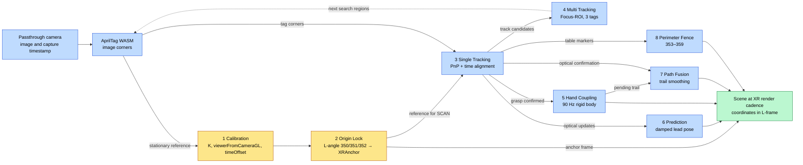
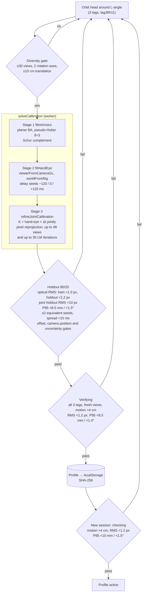
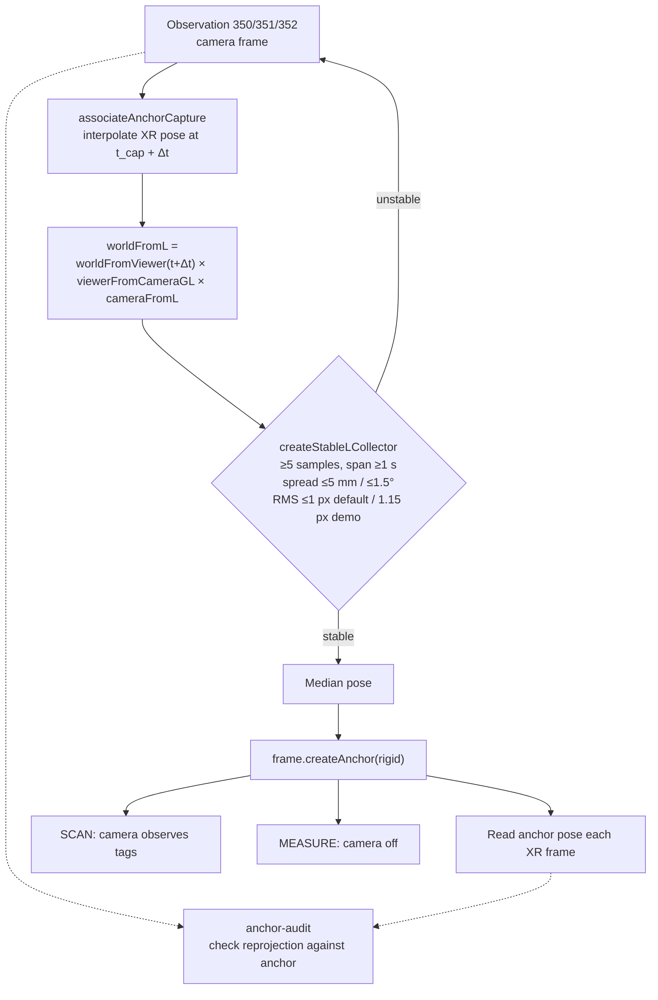
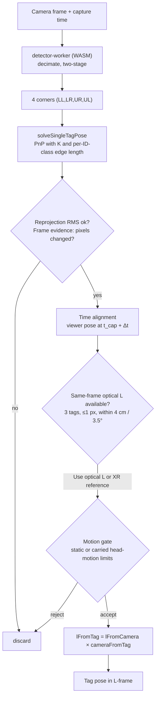
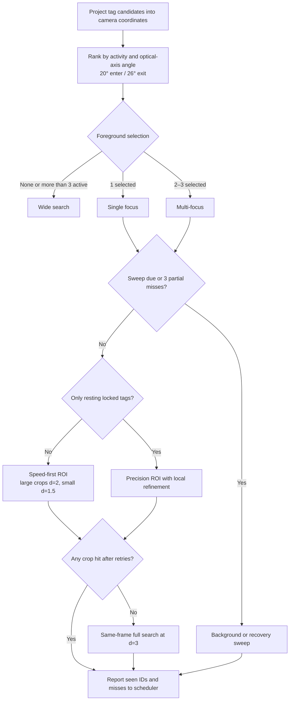
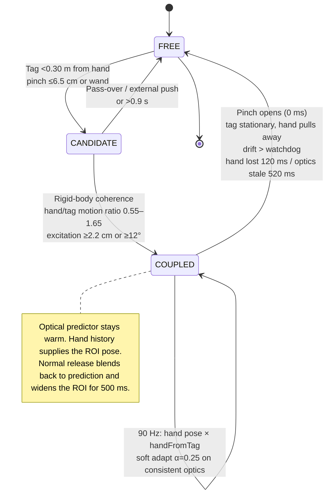
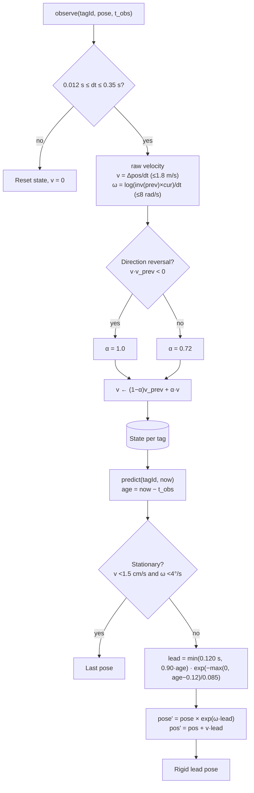
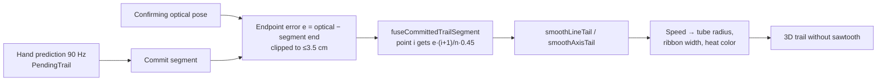
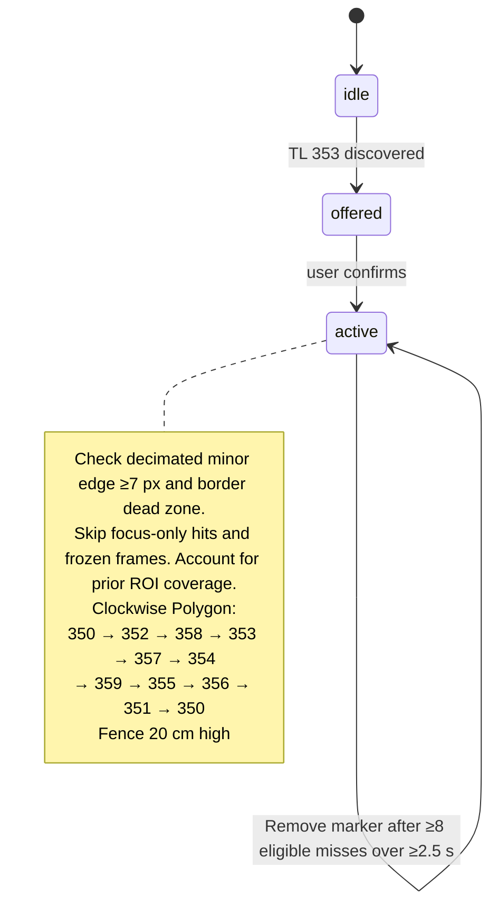

<!-- GENERATED by scripts/build-diagrams.mjs from docs/diagrams/*.mmd. Do not edit. -->
# Diagrams (Graphical Abstracts)

- [Overview](#overview)
- [Calibration](#calibration)
- [Origin Tracking (L-angle → XRAnchor)](#origin-tracking-langle--xranchor)
- [Single Tracking](#single-tracking)
- [Multi Tracking (Focus-ROI)](#multi-tracking-focusroi)
- [Hand Coupling](#hand-coupling)
- [Prediction](#prediction)
- [Path Fusion & Smoothing](#path-fusion--smoothing)
- [Perimeter Fence](#perimeter-fence)

## Overview

All modules in context; yellow = one-time, blue = live, green = output.

Technical papers · [English](../paper/overview.qmd) | [Deutsch](../paper/uebersicht.qmd)

## Calibration

`solveCalibration` in `src/solver.mjs`, gates from `docs/architecture.md`.

Camera extrinsics and time offset · [English](../paper/01-calibration.qmd) | [Deutsch](../paper/01-kalibrierung.qmd)

## Origin Tracking (L-angle → XRAnchor)

`src/anchor.mjs`, `src/anchor-audit.mjs`.

Technical paper · [English](../paper/02-world-origin.qmd) | [Deutsch](../paper/02-raumursprung.qmd)

## Single Tracking

detection → PnP → time alignment → motion gate (`src/detector.mjs`, `src/motion-guard.mjs`).

Technical paper · [English](../paper/03-single-tag.qmd) | [Deutsch](../paper/03-einzelmarker.qmd)

## Multi Tracking (Focus-ROI)

Movable tags 300–349 (`src/camera.mjs`, `docs/controls.md`).

Technical paper · [English](../paper/04-multi-tag-focus.qmd) | [Deutsch](../paper/04-mehrmarker-fokus.qmd)

## Hand Coupling

`src/hand-coupling.mjs`.

Technical paper · [English](../paper/05-hand-coupling.qmd) | [Deutsch](../paper/05-handkopplung.qmd)

## Prediction

Damped Constant-Velocity 6DOF (`src/tag-predictor.mjs`).

Technical paper · [English](../paper/06-prediction.qmd) | [Deutsch](../paper/06-praediktion.qmd)

## Path Fusion & Smoothing

`src/path-smoother.mjs`.

Technical paper · [English](../paper/07-trajectory-correction.qmd) | [Deutsch](../paper/07-bahnkorrektur.qmd)

## Perimeter Fence

`src/perimeter-fence.mjs`.

Technical paper · [English](../paper/08-perimeter.qmd) | [Deutsch](../paper/08-tischkontur.qmd)

