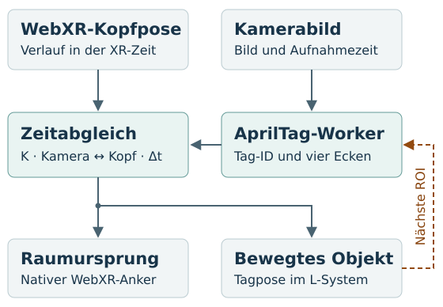

[English](index.html){hreflang=en lang=en} · **Deutsch**

[Zur Übersicht der acht Fachdiagramme und Kurzpaper](uebersicht.html)

{#fig-architecture width=100% fig-alt="Kamerabild und Kopfpose werden über AprilTag-Detektion, Kalibrierung und Zeitabgleich zusammengeführt. Ein nativer Anker trägt den Ursprung. Die Objektpose steuert die nächste Suchregion."}

## Vom Kamerabild zum Raumursprung

Die Quest liefert Kamerabilder über `getUserMedia()` und Kopfposen im WebXR-Renderzyklus. Während ein Bild im Detektor ist, überspringt die Aufnahme weitere Bilder. So wächst bei hoher Rechenlast keine Warteschlange mit immer älteren Aufnahmen. Ein Worker gewinnt aus dem Graubild Tag-ID und vier Bildecken. Die bekannten Eckkoordinaten eines starren L-Winkels mit drei Tags geben dem planaren Pose-Fit Orientierung und Maßstab. Bei einem einzelnen beweglichen Tag übernimmt die bekannte Kantenlänge diese metrische Referenz. [Aufnahme][capture] · [Detektor-Worker][worker] · [Pose-Fit][rig]

Für die Kalibrierung bleibt der Winkel liegen, während der Nutzer den Kopf dreht und versetzt. Der Solver verlangt mindestens 30 Ansichten, Drehung um verschiedene Achsen und mindestens 10 cm Translationsspanne. Die Distanzänderung hilft, Brennweite und Versatz der Kamera zum Kopf auseinanderzuhalten. Der Solver schätzt Kameramodell $K$, starre Kamera-Kopf-Transformation und Zeitversatz $\Delta t$. Das zeitlich letzte Fünftel der Ansichten bleibt für die Validierung reserviert. [Bewegungsprüfung][diversity] · [Solver und Holdout][solver]

Die optische Pose des Winkels wird mit der Kopfpose **zum korrigierten Aufnahmezeitpunkt** verkettet. $W$ bezeichnet den WebXR-Raum, $H$ den Kopf, $C$ die Kamera in WebGL-Achsen und $L$ den Winkel. [Zeitzuordnung][time] · [Transformationskette][chain]

$$
T_{W\leftarrow L} =
T_{W\leftarrow H}(t_\mathrm{Bild}+\Delta t)\,
T_{H\leftarrow C}\, T_{C\leftarrow L}.
$$

::: {.column-margin}
Das verifizierte Kameraprofil kann in `localStorage` weitere Sitzungen überdauern. Bei einem gespeicherten Profil prüft der Assistent neue Ansichten. Der räumliche Anker gilt für die einzelne XR-Sitzung. [Profil][profile] · [Verifikation][verify] · [Ankerzustand][anchor-state]
:::

Mindestens fünf konsistente Beobachtungen über mindestens eine Sekunde geben den Ursprung zur Übergabe frei. Danach liest die App die Pose des `XRAnchor` in jedem XR-Frame. Fehlt eine gültige Ankerpose, meldet der Ankercontroller den Verlust. Die Quest-Demo startet nach der Übergabe im Modus **SCAN**, damit sie weitere Tags beobachten kann. Der Wechsel zu **MEASURE** stoppt die Kamera. [Stabilitätsprüfung][collector] · [Ankerübergabe][anchor-update] · [SCAN][scan-start] · [MEASURE][measure]

## Wie die Bewegung das Suchfenster steuert

Für einen frei bewegten Tag berechnet die App aus aufeinanderfolgenden optischen Posen eine lineare und eine Winkelgeschwindigkeit. Sie begrenzt die lineare Geschwindigkeit auf 1,8 m/s. Üblicherweise geht die neue Geschwindigkeitsmessung mit Gewicht 0,58 ein. Kehrt sich die Bewegungsrichtung um, erhält die neue Messung sofort volles Gewicht. Zwischen Messungen rechnet der Prädiktor mit 72 % des Beobachtungsalters voraus. Er begrenzt diesen Vorlauf auf 105 ms und dämpft ihn ab einem Alter von 120 ms exponentiell. Damit bleibt die Fortschreibung bei einer Sichtlücke begrenzt. [Geschwindigkeitsschätzung und Vorlauf][predictor]

Im XR-Frame glättet die App die vorausgerechnete Pose für die Anzeige. **Diese geglättete Pose liefert die Suchmitte.** Die App projiziert sie mit der jüngsten gültigen Kopf- und Ankerpose sowie den Kameraintrinsiken ins Bild. Die halbe Fensterbreite wächst mit der sichtbaren Tagkante und dem Tempo und liegt zwischen 110 und 240 Pixeln. Am Bildrand wird das Fenster beschnitten. Bei einem handgekoppelten Tag kann stattdessen die Handpose die Anzeige führen und mit der letzten optischen Position in die Suchmitte eingehen. [Anzeigepose][display] · [Kandidaten und Fensterbreite][focus] · [Bildprojektion][projection]

Die Demo fordert bei aktiver Fokussuche höchstens 28 Kamerabilder pro Sekunde zur Auswertung an. Der Worker sucht zuerst in den zulässigen Fenstern. Liefert keines einen Marker, beginnt noch für dasselbe Bild die zweistufige Suche über das Gesamtbild. Auch bei Treffern plant die Demo einen breiteren Suchlauf ein, bei einem aktiven Tag ohne laufende Aufzeichnung nach 20 erfolgreichen Fokusbeobachtungen. So können weitere Tags wieder ins Blickfeld kommen. [Rückfall im Detektor][fallback] · [Suchplanung und Abtastrate][schedule] · [Zählung abgeschlossener Beobachtungen][counter]

## Experiment mit einem Richtungswechsel

Verschiebe den Regler von **Bild 7 über Bild 8 zu Bild 9**. Die Punkte sind die bis dahin bekannten Tagzentren. Das Kreuz ist die projizierte Suchmitte, das farbige Fenster der geplante Bildausschnitt. Das offene Quadrat zeigt die bekannte Tagfläche des synthetischen Folgebilds. Erst nachdem das Fenster feststeht, wird geprüft, ob alle vier Ecken hineinpassen.



::: {.column-margin}
**Modellannahmen.** Ein frontaler 20-mm-Tag bewegt sich in 55 cm Tiefe parallel zu einer festen Kamera. Das Modell verwendet 1.280 × 1.080 Pixel, 880 Pixel Brennweite, zehn synthetische Beobachtungen und 90 Anzeigeschritte pro Sekunde. Die Auswertung zeigt die geometrische Abdeckung. Ob ein realer Tag decodierbar ist, hängt unter anderem von Bewegungsunschärfe und Kontrast ab. [Fokussuche im Worker][focus-worker]
:::

Aus Bild 7 ergibt sich ein Suchfenster von 401 × 401 Pixeln. Das sind 11,6 % des Kamerabilds, und der Tag liegt im Folgebild vollständig darin. In Bild 8 kennt der Prädiktor weiterhin nur die Bewegung nach rechts. Die Umkehr wird erst in Bild 9 sichtbar. Eine erfolgreiche Wiedererfassung liefert dann die neue Geschwindigkeitsrichtung. Die Flächenquote beschreibt die Größe des ersten Suchausschnitts. Laufzeit und Erkennungsrate erfordern Messungen am Detektor.

## Messwerte und Geltungsbereich

Der Projektbericht dokumentiert Läufe auf einer Meta Quest 3 mit Oculus Browser 157 und Kameraauflösung 1.280 × 1.080. Die drei Werte beziehen sich auf unterschiedliche Operationen. [Hardwaremessungen][bench] · [Betriebszustand der FPS-Messung][release-readme]

| Größe | Berichteter Wert | Was gemessen wurde |
|:------|:-----------------|:-------------------|
| Bildrate | 89–90 FPS | XR-Renderzyklus mit nativem Anker und ausgeschalteter Kamera |
| Reprojektionsfehler | 0,27–0,37 px RMS | Bildecken des Kalibrierrigs in zurückgehaltenen Ansichten |
| Wiederholbarkeit | 2–4 mm | Wiederholte Messungen über eine Strecke von 1 m in verschiedenen Sitzungen |

Für die absolute räumliche Genauigkeit fehlt eine unabhängige Referenzmessung. Der Solver kennzeichnet sein Ergebnis als `independentlyValidated: false`. Die optische Prüfung vergleicht die beobachtete Referenz mit dem nativen Anker und protokolliert die Abweichung. Eine Korrektur des Ankers ist in diesem Pfad ausdrücklich deaktiviert. Alle Codebelege beziehen sich auf den veröffentlichten Stand **v1.2.0**. [Solver-Ergebnis][solver] · [Optische Ankerprüfung][audit] · [Quellstand][revision]

[capture]: https://github.com/PiMaV/Quest3-WebXR-AprilTag/blob/591ecff5c23375c217cf0922b9ea1834f86c40ed/src/camera.mjs#L94-L254
[worker]: https://github.com/PiMaV/Quest3-WebXR-AprilTag/blob/591ecff5c23375c217cf0922b9ea1834f86c40ed/src/detector-worker.js#L93-L171
[rig]: https://github.com/PiMaV/Quest3-WebXR-AprilTag/blob/591ecff5c23375c217cf0922b9ea1834f86c40ed/src/rig.mjs#L292-L438
[diversity]: https://github.com/PiMaV/Quest3-WebXR-AprilTag/blob/591ecff5c23375c217cf0922b9ea1834f86c40ed/src/solver.mjs#L172-L191
[solver]: https://github.com/PiMaV/Quest3-WebXR-AprilTag/blob/591ecff5c23375c217cf0922b9ea1834f86c40ed/src/solver.mjs#L257-L306
[time]: https://github.com/PiMaV/Quest3-WebXR-AprilTag/blob/591ecff5c23375c217cf0922b9ea1834f86c40ed/src/profile.mjs#L68-L118
[chain]: https://github.com/PiMaV/Quest3-WebXR-AprilTag/blob/591ecff5c23375c217cf0922b9ea1834f86c40ed/examples/minimal.mjs#L288-L327
[profile]: https://github.com/PiMaV/Quest3-WebXR-AprilTag/blob/591ecff5c23375c217cf0922b9ea1834f86c40ed/src/profile.mjs#L121-L134
[verify]: https://github.com/PiMaV/Quest3-WebXR-AprilTag/blob/591ecff5c23375c217cf0922b9ea1834f86c40ed/src/assistant.mjs#L25-L33
[anchor-state]: https://github.com/PiMaV/Quest3-WebXR-AprilTag/blob/591ecff5c23375c217cf0922b9ea1834f86c40ed/src/anchor.mjs#L119-L139
[collector]: https://github.com/PiMaV/Quest3-WebXR-AprilTag/blob/591ecff5c23375c217cf0922b9ea1834f86c40ed/src/anchor.mjs#L3-L108
[anchor-update]: https://github.com/PiMaV/Quest3-WebXR-AprilTag/blob/591ecff5c23375c217cf0922b9ea1834f86c40ed/src/anchor.mjs#L166-L209
[scan-start]: https://github.com/PiMaV/Quest3-WebXR-AprilTag/blob/591ecff5c23375c217cf0922b9ea1834f86c40ed/examples/quest.mjs#L6398-L6417
[measure]: https://github.com/PiMaV/Quest3-WebXR-AprilTag/blob/591ecff5c23375c217cf0922b9ea1834f86c40ed/examples/quest.mjs#L6527-L6551
[predictor]: https://github.com/PiMaV/Quest3-WebXR-AprilTag/blob/591ecff5c23375c217cf0922b9ea1834f86c40ed/src/tag-predictor.mjs#L27-L123
[display]: https://github.com/PiMaV/Quest3-WebXR-AprilTag/blob/591ecff5c23375c217cf0922b9ea1834f86c40ed/examples/quest.mjs#L4717-L4835
[focus]: https://github.com/PiMaV/Quest3-WebXR-AprilTag/blob/591ecff5c23375c217cf0922b9ea1834f86c40ed/examples/quest.mjs#L6673-L6752
[projection]: https://github.com/PiMaV/Quest3-WebXR-AprilTag/blob/591ecff5c23375c217cf0922b9ea1834f86c40ed/src/detector.mjs#L113-L170
[fallback]: https://github.com/PiMaV/Quest3-WebXR-AprilTag/blob/591ecff5c23375c217cf0922b9ea1834f86c40ed/src/detector.mjs#L613-L644
[schedule]: https://github.com/PiMaV/Quest3-WebXR-AprilTag/blob/591ecff5c23375c217cf0922b9ea1834f86c40ed/examples/quest.mjs#L6734-L6810
[counter]: https://github.com/PiMaV/Quest3-WebXR-AprilTag/blob/591ecff5c23375c217cf0922b9ea1834f86c40ed/examples/quest.mjs#L6834-L6847
[focus-worker]: https://github.com/PiMaV/Quest3-WebXR-AprilTag/blob/591ecff5c23375c217cf0922b9ea1834f86c40ed/src/detector.mjs#L465-L543
[bench]: https://github.com/PiMaV/Quest3-WebXR-AprilTag/blob/591ecff5c23375c217cf0922b9ea1834f86c40ed/docs/benchmarks.md#L5-L17
[release-readme]: https://github.com/PiMaV/Quest3-WebXR-AprilTag/blob/591ecff5c23375c217cf0922b9ea1834f86c40ed/README.md#L27-L35
[audit]: https://github.com/PiMaV/Quest3-WebXR-AprilTag/blob/591ecff5c23375c217cf0922b9ea1834f86c40ed/src/anchor-audit.mjs#L38-L68
[revision]: https://github.com/PiMaV/Quest3-WebXR-AprilTag/tree/591ecff5c23375c217cf0922b9ea1834f86c40ed
