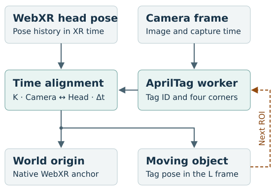

**English** · [Deutsch](bewegter-tag.html){hreflang=de lang=de}

[Overview of the eight diagrams and papers](overview.html)

**Version note.** The pendulum experiment below reproduces v1.2.0. The current [multi-tag search](04-multi-tag-focus.html), [hand coupling](05-hand-coupling.html) and [prediction](06-prediction.html) chapters describe the revised scheduler, release behaviour and lead parameters.

{#fig-architecture width=100% fig-alt="Calibration and time alignment combine detected tag corners with head poses. A native anchor carries the origin. The moving object pose guides the next image search."}

## From a camera image to a world origin

The Quest supplies camera images through `getUserMedia()` and head poses through the WebXR render loop. While the detector is processing one image, the capture loop skips incoming frames. This prevents older images from accumulating under load. A worker extracts tag IDs and four corners from the grayscale image. The known corner coordinates of three tags on a rigid L-shaped target give the planar pose fit its orientation and metric scale. For a single moving tag, the known edge length supplies the metric reference. [Capture][capture] · [Detector worker][worker] · [Pose fit][rig]

During calibration, the target stays still while the user rotates and translates their head. The solver requires at least 30 views, rotations about different axes and at least 10 cm of translation span. Varying the distance helps separate focal length from the offset between the camera and the viewer. The solver estimates camera model $K$, the rigid camera-to-viewer transform and time offset $\Delta t$. The final fifth of the views in capture order is reserved for validation. [Motion checks][diversity] · [Solver and holdout][solver]

The optical target pose is combined with the head pose **at the corrected capture time**. Let $W$ denote the WebXR world, $H$ the viewer, $C$ the camera in WebGL coordinates and $L$ the L-shaped target. [Time alignment][time] · [Transform chain][chain]

$$
T_{W\leftarrow L} =
T_{W\leftarrow H}(t_\mathrm{image}+\Delta t)\,
T_{H\leftarrow C}\, T_{C\leftarrow L}.
$$

::: {.column-margin}
A verified camera profile can persist across sessions in `localStorage`. The assistant checks a saved profile using fresh views. The spatial anchor is valid for a single XR session. [Profile][profile] · [Verification][verify] · [Anchor state][anchor-state]
:::

At least five consistent observations spanning at least one second allow the origin to be handed over. The app then reads the `XRAnchor` pose on every XR frame. If no valid anchor pose is available, the anchor controller reports the loss. After handover, the Quest demo starts in **SCAN** mode to observe additional tags. Switching to **MEASURE** stops the camera. [Stability check][collector] · [Anchor handover][anchor-update] · [SCAN][scan-start] · [MEASURE][measure]

## How motion guides the search window

For a freely moving tag, the app estimates linear and angular velocity from successive optical poses. It caps linear speed at 1.8 m/s. A new velocity measurement normally receives a weight of 0.58. When the direction reverses, the new measurement immediately receives full weight. Between observations, the predictor extrapolates by 72% of the observation age, capped at 105 ms. Once the observation is 120 ms old, exponential damping reduces the lead. This bounds extrapolation during a gap in visibility. [Velocity estimate and prediction horizon][predictor]

On each XR frame, the app smooths the predicted pose for display. **This smoothed pose sets the search centre.** The app projects it into the image using the latest valid head and anchor poses and the camera intrinsics. The window half-width grows with the apparent tag edge length and speed, ranging from 110 to 240 pixels. The window is clipped at the image boundary. For a hand-coupled tag, the hand pose can drive the display and contribute to the search centre alongside the latest optical position. [Display pose][display] · [Candidates and window size][focus] · [Image projection][projection]

With focused search active, the demo requests at most 28 camera frames per second for processing. The worker searches the eligible windows first. If none yields a marker, it starts a two-stage full-image search on the same frame. The demo also schedules wider searches after successful detections. With one active tag and recording stopped, it does so after 20 successful focused observations. This gives other tags a chance to enter the track. [Detector fallback][fallback] · [Search schedule and rate][schedule] · [Completed observations][counter]

## Try a direction reversal

Move the slider **from frame 7 through frame 8 to frame 9**. The dots are the tag centres observed so far. The cross marks the projected search centre, and the shaded box shows the planned search window. The open square shows the known tag footprint in the next synthetic frame. Only after the window has been chosen does the model test whether all four corners fit inside.



::: {.column-margin}
**Model assumptions.** A front-facing 20 mm tag moves parallel to a fixed camera at a depth of 55 cm. The model uses a 1280 × 1080 image, an 880 px focal length, ten synthetic observations per second and 90 display updates per second. It tests geometric coverage. Decoding a physical tag also depends on conditions such as motion blur and contrast. [Focused search in the worker][focus-worker]
:::

Frame 7 gives a 401 × 401 px search window covering 11.6% of the camera image. It contains the entire tag in the next frame. At frame 8, the predictor has still seen only rightward motion. The reversal first becomes visible in frame 9. Reacquiring the tag supplies the new velocity direction. The area ratio measures the size of the first image crop. Detector runtime and detection rate require measurements on the detector itself.

## Measurements and scope

The project report documents runs on a Meta Quest 3 using Oculus Browser 157 and a camera resolution of 1280 × 1080. The three values below describe different operations. [Hardware measurements][bench] · [Operating mode for the frame-rate measurement][release-readme]

| Quantity | Reported value | What was measured |
|---|---|---|
| Frame rate | 89–90 FPS | XR render loop with a native anchor and the camera switched off |
| Reprojection error | 0.27–0.37 px RMS | Calibration target corners in held-out views |
| Repeatability | 2–4 mm | Repeated measurements over a 1 m distance in different sessions |

An independent reference measurement for absolute spatial accuracy is still missing. The solver marks its result as `independentlyValidated: false`. The optical audit compares the observed reference with the native anchor and logs the deviation. Anchor correction is explicitly disabled in this path. All code references refer to the published **v1.2.0** revision. [Solver output][solver] · [Optical anchor audit][audit] · [Source revision][revision]

[capture]: https://github.com/PiMaV/Quest3-WebXR-AprilTag/blob/591ecff5c23375c217cf0922b9ea1834f86c40ed/src/camera.mjs#L94-L254
[worker]: https://github.com/PiMaV/Quest3-WebXR-AprilTag/blob/591ecff5c23375c217cf0922b9ea1834f86c40ed/src/detector-worker.js#L93-L171
[rig]: https://github.com/PiMaV/Quest3-WebXR-AprilTag/blob/591ecff5c23375c217cf0922b9ea1834f86c40ed/src/rig.mjs#L292-L438
[diversity]: https://github.com/PiMaV/Quest3-WebXR-AprilTag/blob/591ecff5c23375c217cf0922b9ea1834f86c40ed/src/solver.mjs#L172-L191
[solver]: https://github.com/PiMaV/Quest3-WebXR-AprilTag/blob/591ecff5c23375c217cf0922b9ea1834f86c40ed/src/solver.mjs#L257-L306
[time]: https://github.com/PiMaV/Quest3-WebXR-AprilTag/blob/591ecff5c23375c217cf0922b9ea1834f86c40ed/src/profile.mjs#L68-L118
[chain]: https://github.com/PiMaV/Quest3-WebXR-AprilTag/blob/591ecff5c23375c217cf0922b9ea1834f86c40ed/examples/minimal.mjs#L288-L327
[profile]: https://github.com/PiMaV/Quest3-WebXR-AprilTag/blob/591ecff5c23375c217cf0922b9ea1834f86c40ed/src/profile.mjs#L121-L134
[verify]: https://github.com/PiMaV/Quest3-WebXR-AprilTag/blob/591ecff5c23375c217cf0922b9ea1834f86c40ed/src/assistant.mjs#L25-L33
[anchor-state]: https://github.com/PiMaV/Quest3-WebXR-AprilTag/blob/591ecff5c23375c217cf0922b9ea1834f86c40ed/src/anchor.mjs#L119-L139
[collector]: https://github.com/PiMaV/Quest3-WebXR-AprilTag/blob/591ecff5c23375c217cf0922b9ea1834f86c40ed/src/anchor.mjs#L3-L108
[anchor-update]: https://github.com/PiMaV/Quest3-WebXR-AprilTag/blob/591ecff5c23375c217cf0922b9ea1834f86c40ed/src/anchor.mjs#L166-L209
[scan-start]: https://github.com/PiMaV/Quest3-WebXR-AprilTag/blob/591ecff5c23375c217cf0922b9ea1834f86c40ed/examples/quest.mjs#L6398-L6417
[measure]: https://github.com/PiMaV/Quest3-WebXR-AprilTag/blob/591ecff5c23375c217cf0922b9ea1834f86c40ed/examples/quest.mjs#L6527-L6551
[predictor]: https://github.com/PiMaV/Quest3-WebXR-AprilTag/blob/591ecff5c23375c217cf0922b9ea1834f86c40ed/src/tag-predictor.mjs#L27-L123
[display]: https://github.com/PiMaV/Quest3-WebXR-AprilTag/blob/591ecff5c23375c217cf0922b9ea1834f86c40ed/examples/quest.mjs#L4717-L4835
[focus]: https://github.com/PiMaV/Quest3-WebXR-AprilTag/blob/591ecff5c23375c217cf0922b9ea1834f86c40ed/examples/quest.mjs#L6673-L6752
[projection]: https://github.com/PiMaV/Quest3-WebXR-AprilTag/blob/591ecff5c23375c217cf0922b9ea1834f86c40ed/src/detector.mjs#L113-L170
[fallback]: https://github.com/PiMaV/Quest3-WebXR-AprilTag/blob/591ecff5c23375c217cf0922b9ea1834f86c40ed/src/detector.mjs#L613-L644
[schedule]: https://github.com/PiMaV/Quest3-WebXR-AprilTag/blob/591ecff5c23375c217cf0922b9ea1834f86c40ed/examples/quest.mjs#L6734-L6810
[counter]: https://github.com/PiMaV/Quest3-WebXR-AprilTag/blob/591ecff5c23375c217cf0922b9ea1834f86c40ed/examples/quest.mjs#L6834-L6847
[focus-worker]: https://github.com/PiMaV/Quest3-WebXR-AprilTag/blob/591ecff5c23375c217cf0922b9ea1834f86c40ed/src/detector.mjs#L465-L543
[bench]: https://github.com/PiMaV/Quest3-WebXR-AprilTag/blob/591ecff5c23375c217cf0922b9ea1834f86c40ed/docs/benchmarks.md#L5-L17
[release-readme]: https://github.com/PiMaV/Quest3-WebXR-AprilTag/blob/591ecff5c23375c217cf0922b9ea1834f86c40ed/README.md#L27-L35
[audit]: https://github.com/PiMaV/Quest3-WebXR-AprilTag/blob/591ecff5c23375c217cf0922b9ea1834f86c40ed/src/anchor-audit.mjs#L38-L68
[revision]: https://github.com/PiMaV/Quest3-WebXR-AprilTag/tree/591ecff5c23375c217cf0922b9ea1834f86c40ed
